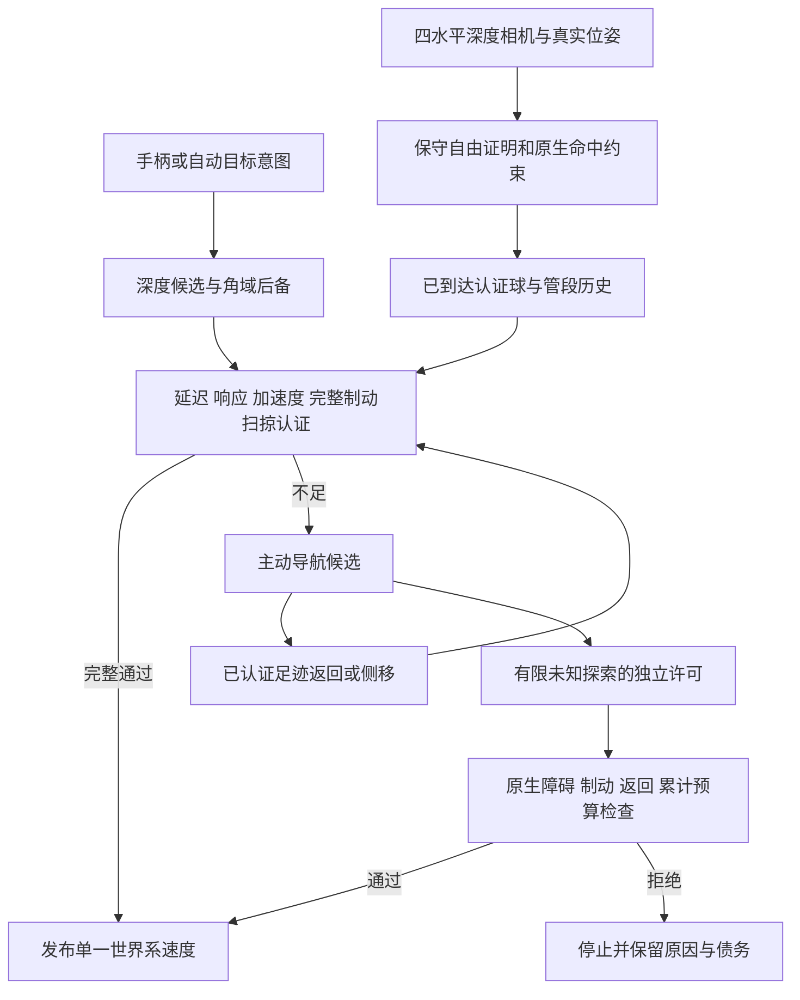

# EGO2P6 避障算法与执行流程

当前继承P5 c36；复制适配时间2026-10-19 19:41。完整参数、来源成绩、本次独立验证和未通过项见[EGO2P6_VERSION.md](EGO2P6_VERSION.md)。本次P6未新增飞行。

正常方向由真实深度候选优先，失败后保留角域调和场/流盒路径。候选有效不等于可执行，名义过渡与完全制动必须从当前真实状态认证；实际发布目标记录与未执行提名分离。计算超时后发送的零目标会同步核心，避免把被取消命令当成实际运动。

未知不能进入自由证据。普通认证不足时，局部恢复可先尝试仍有完整证明的足迹返回，或水平认证侧移；只有另行通过真实障碍、制动/返回、3.5m/12活跃秒/5m³累计预算检查，才允许低速EXPLORATORY执行。松杆、换锚点、跨周期不会补额度；事件只在实际位移和新观测证明完成后闭合。

几何查询每周期按观测版本精确复用；整条分段曲线的保守包络仅用于粗筛必不相交原生点，近点仍逐段精查。主动提名.3s/.75m优先重证不等于复用执行许可。目标停滞2s后以1Hz重新请求可靠足迹；普通和局部恢复交替不会清除停滞计时。

边界15cm进入/35cm退出、可靠足迹范围.12–3m、四档认证返回、边界受阻后的水平视差等均为继承c36的工程局部策略。用户排除到顶/到底斜角围困，后续不专门优化该排除工况；原始状态、录像仍留P5，普通卡停或计算问题继续统计。

当前保存profile：10m/s请求、垂向1、depth20/H.5、a16/tau.10/延迟.20、硬.595/重启.615/可靠锚点.635m、普通额外舒适.08m/恢复0。四水平相机、无垂直相机、无在线全图真值。原六附加模块仅深度不确定性开，速度平滑关；普通历史16份仍工作。

主要代码：`src/pc_gvf/src/depth_angular_controller_node.cpp`、`paper_guidance.cpp`、`active_navigation.cpp`、`omni_depth.cpp`、`paper_replay.cpp`，头文件位于`src/pc_gvf/include/pc_gvf`。来源旧机制说明保留为[EGO2P5_ACTIVE_NAVIGATION.md](../../EGO2P5/ACTIVE_NAVIGATION.md)。

当前路线配置已迁入src/pc_gvf/config；本机运行默认不保存大型二进制重放，EGO2P6_RECORD_REPLAYS=1按需开启。此开关只控制诊断写盘，完整认证与风险账本不变。
